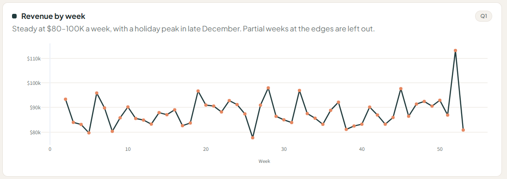
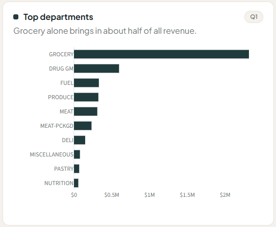
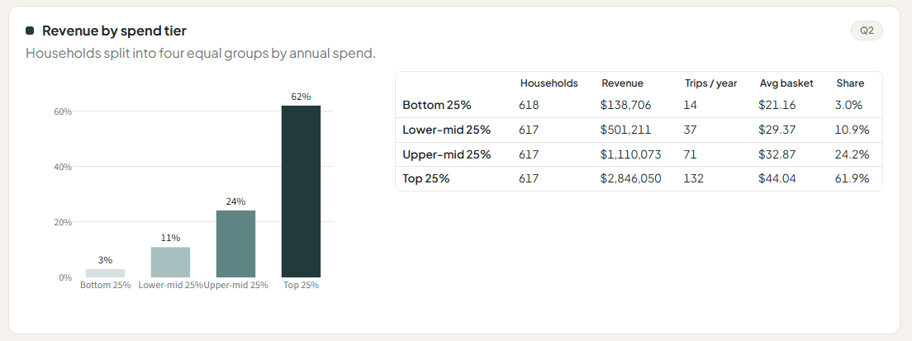
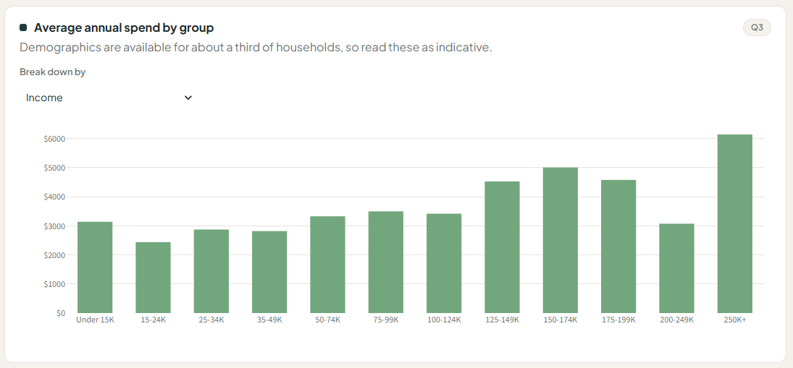
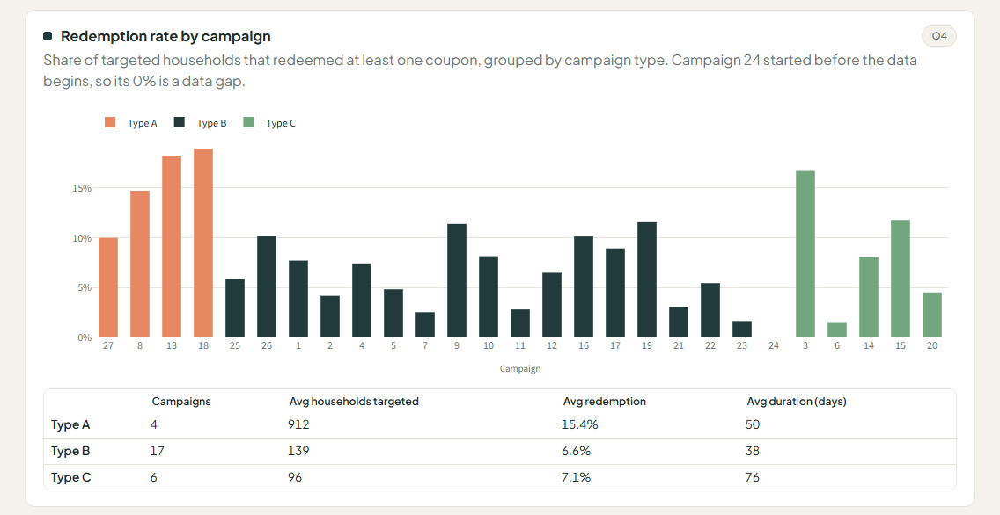
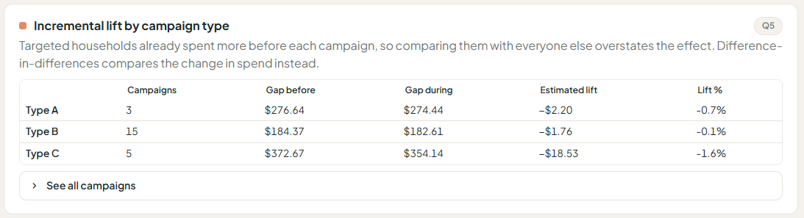

# Grocery Sales & Campaign Effectiveness

> **Live app:** https://grocery-campaign-analysis-ir87stg5hcsdkwx98k7kuj.streamlit.app/

## Business problem
A grocery retailer spends money on marketing campaigns and coupons every year.
Management wants to know **which customers drive revenue** and **whether campaigns actually make customers spend more**, or just give discounts to people who would have bought anyway.

## Key questions
1. How do sales move across the year, and which departments and categories drive revenue?
2. How concentrated is revenue? What share comes from the top 25% of households?
3. Which demographic groups spend the most per household?
4. Which campaigns and campaign types get the highest coupon redemption?
5. Did campaigns increase spending among targeted households, after accounting for the fact that they already spent more?

## Key findings
1. **Revenue is highly concentrated, and shopping frequency drives it.** The top 25% of households generate **61.9% of revenue**, while the bottom 25% generate just 3.0%. Top households shop **132 times a year vs. 14** (over 9×), but their baskets are only about 2× larger ($44 vs. $21).
2. **Type A campaigns get twice the redemption at much larger scale.** Type A campaigns reach **15% redemption vs. 7%** for Types B and C, while targeting about **6.5× more households** on average (912 vs. 96–139).
3. **Campaigns did not measurably increase spending.** Targeted households already spent **$237 more** than non-targeted households *before* campaigns started. After removing that gap with difference-in-differences, the average lift across 23 campaigns is **−$5.46 per household (about 0%)**. Coupon users spend 2.7× more ($3,890 vs. $1,458), but that reflects *who gets targeted*, not campaign impact.

**Recommendation:** Stop judging campaigns by redemption rate. It rewards targeting loyal customers who would buy anyway. Run every campaign with a **random holdout group** to measure incremental sales, and test campaigns on **mid-tier households**, where raising visit frequency has the most room to grow revenue.

## Answers to the key questions

**Q1. How do sales move across the year, and what drives revenue?**
Total revenue is **$4.60M** from 155,848 baskets (average basket **$29.49**). Weekly revenue stays in a narrow **$78–98K** band almost every week, with no upward trend; the only clear peak is Christmas week (~$113K). **Grocery** brings in about half of all revenue, followed by Drug/GM, Fuel, Produce and Meat. The top real product categories are soft drinks, beef and milk.




**Q2. How concentrated is revenue?**
Very. The **top 25% of households generate 61.9%** of revenue, and the bottom 50% only 13.9%. The gap comes mostly from **visit frequency** (132 vs. 14 trips a year), not basket size ($44 vs. $21).



**Q3. Which demographic groups spend the most?**
Spending generally rises with income: households earning **$250K+ spend about twice as much** per year as those under $50K. The trend is not perfectly smooth (the $200–249K group dips), and demographics cover only about a third of households, so treat this as indicative.



**Q4. Which campaigns get the highest redemption?**
**Type A** campaigns: **15.4%** of targeted households redeem, vs. 6.6% (Type B) and 7.1% (Type C), even though Type A targets far more households (912 vs. 96–139 on average). Several campaigns (6, 7, 11, 21, 23) reach only about 3% or less.



**Q5. Did campaigns increase spending?**
**No measurable increase.** Targeted households already spent $237 more than others before campaigns began, and that gap barely changed during campaigns. The average difference-in-differences lift is **−$5.46 per household (≈ 0%)**, and every campaign type is close to zero (A −0.7%, B −0.1%, C −1.6%).



## What this means for the business
The retailer is **stable but not growing**, and its marketing money is not working hard enough:

- **Discounts with no return.** 15.2% of the value of goods sold is given away as discounts, and campaigns produce roughly zero extra spend. That is margin lost, not sales gained.
- **Dependence on a small loyal core.** Losing a modest number of top-tier households would hit revenue hard, while the bottom half of customers contributes very little.
- **No growth.** Weekly revenue moves within a narrow band all year, with no upward trend apart from the holiday spike.

The opportunity is in **mid-tier households** (37–71 trips a year): moving them toward top-tier visit frequency would grow revenue far more than rewarding customers who already shop every few days.

## Data
**The Complete Journey 2.0** by 84.51° (Kroger's data science company), via the
[`completejourney`](https://github.com/bradleyboehmke/completejourney) package. License: CC0.

| Table | What it contains |
|---|---|
| transactions | 1.47M purchase lines from 2,469 households over one year |
| products | department, category, brand for each product |
| demographics | age, income, household size etc. (about 800 households) |
| campaigns | which households received which campaign |
| campaign_descriptions | campaign type (A/B/C) and dates |
| coupon_redemptions | which household redeemed which coupon, and when |

## Method
- **SQL / pandas:** aggregation, joins across 6 tables, household-level summaries
- **Customer segmentation:** households split into spend quartiles
- **Campaign effectiveness:** difference-in-differences, comparing the change in spend for targeted households against non-targeted households over the same period, so the pre-existing spending gap isn't counted as campaign impact
- **Dashboard:** Streamlit + Plotly

## Limitations
- Demographics exist for only about a third of households.
- Campaign targeting was not random, so the lift estimate is an approximation, not a controlled experiment.
- 4 of 27 campaigns start too early in the data to have a "before" period and are excluded from the lift estimate. Campaign 24 began before the data starts, so its 0% redemption is a data gap, not a failed campaign.
- Small campaigns (e.g. campaign 1, 13 households) give noisy individual estimates; conclusions rely on the average across campaigns.
- "COUPON/MISC ITEMS" is the largest category by revenue but likely contains fuel and gift cards rather than grocery products.
- The first and last weeks of the data are partial and are excluded from the weekly trend.
- The demographic chart's group sizes vary widely; small groups (e.g. $200–249K income) can look unusual by chance.
- One year of data cannot show long-term growth or decline; "flat" describes this year only.
- One year of data from one retailer (US, 2017).

## How to run
```bash
python -m pip install -r requirements.txt
python prepare_data.py          # downloads data into data/ (run once)
python -m streamlit run app.py
```
On Windows, use `py` instead of `python` if `python` isn't recognized.

## Project structure
```
prepare_data.py   download data and save as Parquet
analysis.py       all analysis logic (pandas)
app.py            Streamlit dashboard
images/           screenshots from the live app, used in this README
```